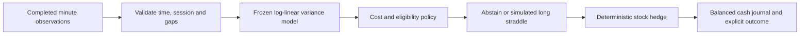

# OrbQuant

**Volatility forecasting · deterministic risk · auditable simulation · paper-only Alpaca access**

OrbQuant is a Python research and engineering portfolio project. It forecasts
short-term market variability, examines a delta-hedged options strategy, and keeps
hard limits, simulated execution and accounting separate from the forecast.

This public edition contains **one frozen, CPU-only log-linear baseline** for SPY
and QQQ. It is a modest demonstration model with useful volatility information;
**statistically reliable profitability has not been established**. A forecast of
larger price movements is not a forecast of positive returns or free profit.

## At a glance

| Component | What it demonstrates |
|---|---|
| ORB: `baseline.py` | Point-in-time features and a transparent frozen variance forecast |
| GUARD: `guard.py` | Independent cash, position, stale-data, loss and drawdown checks for the long-only equity core |
| QUANT: `broker.py`, `ledger.py` | Future-reference simulated fills, order states, transactional SQLite and double-entry accounting |
| Options laboratory: `options.py` | A separate deterministic one-straddle replay with five-minute stock hedges, explicit costs and conservative capital limits |
| Local endpoint block | Live Alpaca REST/WebSocket requests rejected before dispatch |
| Tests and CI | Replay determinism, accounting, timing, missing data and endpoint enforcement |



## Quick start: no key or GPU required

Use Python 3.12. From this public repository on Windows:

```powershell
py -3.12 -m venv .venv
.\.venv\Scripts\python.exe -m pip install -e ".[dev]"
.\.venv\Scripts\python.exe tools/install_guard_startup.py
.\.venv\Scripts\python.exe -m orbquant.demo
.\.venv\Scripts\python.exe -m pytest -q
```

On Linux/macOS use `.venv/bin/python` instead. The startup installer supports both
environment layouts. The demo generates synthetic observations and prints a JSON
forecast, the baseline policy decision and a separate mechanical hedge example.
The latter deliberately supplies an invented high-variance forecast to exercise
the execution path. **Neither output is market performance.** It can be replayed
without network access and does not fit or update any model.

## How the volatility forecast works

At each eligible completed five-minute boundary, the model requires 120 completed,
contiguous, regular-session one-minute bars. It rejects gaps, stale observations,
cross-session inputs and future availability times. At least 60 minutes must
remain after the scheduled next-minute entry. Session timing follows the XNYS
exchange calendar, including holidays, daylight saving and shortened sessions.

The model uses four features:

1. Log realised variance over the last 60 minute-to-minute closing-price returns.
2. Log realised variance over the last 15 returns, multiplied by four to match a
   60-minute scale.
3. Sine of session phase.
4. Cosine of session phase.

The time features refer to the last completed five-minute aggregate's start.
For each instrument, the frozen linear model predicts log variance:

```text
log_variance = intercept + coefficients · features
forecast_variance = calibration_factor × exp(clip(log_variance, -40, 0))
forecast_volatility_bps = sqrt(forecast_variance) × 10,000
```

The target is **integrated variance over 60 future one-minute open-to-open
returns**: the sum of their squared log returns. It is not annualised volatility,
a price target, a directional signal or a calibrated prediction interval.
The next-minute entry is strictly after the decision; no fill uses the closing
price that generated the forecast.

Only inference code and the selected baseline coefficients are distributed.
The model card records fitting and calibration dates. Training code, alternative
models, research notebooks, strategy searches and market datasets are not part of
this public edition. A fresh clone can reproduce the software demo, but cannot
reproduce the historical model fitting without those datasets and procedures.

## Why use delta hedging?

The research hypothesis is that future realised movement can sometimes exceed
the movement priced into options by enough to cover all trading costs.
The options laboratory considers buying one call and one put with the same strike
and expiry: a long straddle. It offsets their combined delta with stock, then
updates that hedge every five minutes. For a long-gamma position, a rising market
typically calls for selling more stock and a falling market for buying stock back.

The screening approximation is:

```text
estimated net edge ≈ ½ × contract_multiplier × gamma × spot² × forecast_variance
                     + contract_multiplier × theta_per_year × holding_years
                     − option spreads and fees − stock trading costs − carry
```

Theta represents time decay and is usually negative for the long straddle. Gamma
and theta are combined across both legs; the example assumes standard 100-share
contracts. The policy abstains unless estimated net edge exceeds a fixed buffer
and premium/reserve limits pass. It also rechecks capital limits at entry and
before adjusting the hedge. The parameters are demonstration assumptions, not
optimised trading recommendations.

**This can lose money even when the variance forecast is accurate.** Spreads,
discrete hedging, jumps, changing implied volatility, dividends, American exercise,
fees, borrowing, funding and forecast errors all matter. The European zero-dividend
Black–Scholes helper is an illustration, not a complete valuation model for ETF
options. See [OCC's introduction to gamma](https://www.optionseducation.org/advancedconcepts/gamma).

The options laboratory is separate from the long-only equity GUARD/QUANT core.
It may simulate short stock hedges; it does not enable those positions in the
long-only core or provide a production options broker. Its cent-rounded journal
records cash and matching counter-postings. Unresolved exits or intrahold gaps
produce **no scored PnL**, rather than invented exit prices. It assumes simultaneous
full fills at supplied bid/ask marks and does not model depth or queue position.

## Alpaca keys and read-only data access

Copy the template, then fill your own key locally:

```powershell
Copy-Item alpaca-credentials.example.toml alpaca-credentials.toml
```

The private file is ignored by Git. Do not put a real key in the example file.
The existing credential loader also accepts documented environment overrides;
never commit `.env` files. The public adapter supports a paper-account status GET
and explicitly selected stock quote feeds. It has **no order submission method**.

```python
from orbquant.market_data import ReadOnlyAlpaca

client = ReadOnlyAlpaca()
print(client.account_status())
quotes = client.latest_quotes(feed="iex")
```

Market data uses `data.alpaca.markets` and `stream.data.alpaca.markets`, independently
of the paper trading host. Subscription permissions still apply. Indicative
option quotes are modified and their trades delayed; they cannot establish
executable option prices. [Official feed definition](https://docs.alpaca.markets/us/reference/optionlatestquotes).
No provider data or actual account information is redistributed here.

## Real Alpaca trading is blocked; only paper endpoints are permitted

Allowed trading origins:

- `https://paper-api.alpaca.markets`
- `wss://paper-api.alpaca.markets/stream`

Blocked live trading origins, including all paths and ports:

- `https://api.alpaca.markets`
- `wss://api.alpaca.markets/stream`

The local guard checks HTTP, redirects, proxies, WebSockets, Python socket hostname
resolution and TLS server names before dispatch. The optional environment startup
hook stops Python if the guard cannot load. There is no `live=true` switch.
Package import also installs the guard. This is application-level protection;
it is not a Windows firewall or a sandbox for arbitrary executables or hostile
code. Details are in [local safety](docs/ALPACA_LOCAL_SAFETY.md).

“Paper-only” describes permitted broker endpoints. The supplied strategy runs in
a local simulator; automatic order placement into an Alpaca paper account is not
implemented. Real and paper orders are never submitted by the demo.

### What would be required to unblock live trading?

This release intentionally does not provide a supported live mode. A maintainer
choosing to build one would need to make an explicit, separately reviewed code
change to the deny policy in `src/orbquant_network_guard.py`, change the import
bootstrap in `src/orbquant/__init__.py` and the environment startup hook installed
by `tools/install_guard_startup.py`, then restart affected processes. Removing
only one layer or changing a URL will not reliably remove the block.

That would only remove a network restriction: **it would not create a live
trading system**. A separate live broker adapter, live account credentials,
reconciliation, durable order recovery, entitlement checks, operational controls
and validation would still be required. The current adapters remain read-only.
This repository does not perform those changes, bypass the block, or represent
that the research strategy is suitable for real capital.

## Research status and honest limits

The selected calibrated persistence/time baseline has shown useful volatility
information in retrospective research, but **no statistically significant
profitability has been demonstrated**. Sparse opportunities, missing option
quotes and cost sensitivity prevent a positive trading claim. Previously examined
historical periods are not described as untouched holdouts. No performance charts
or cherry-picked profitable trades are presented as proof of an edge.

Useful portfolio engineering features include causal feature construction,
separation of statistical and trading evaluation, deterministic execution,
double-entry accounting, recovery tests and local endpoint restrictions.

## Public scope and repository hygiene

This repository has an explicit file allowlist in `.gitignore`. Raw data,
credentials, environments, trained research models, training scripts, notebooks,
experiment reports and private strategy ideas are excluded. The allowlist is
accident prevention, not secret detection: changes to an allowed source file
still require review. Run `python tools/check_public_release.py` before publishing.
The checker also rejects personal machine paths, unexpected email addresses and
nonempty credential-template values. For the anonymous release snapshot, run
`python tools/check_public_release.py --anonymous-history` to verify Git author
and committer metadata as well.

Publish only the tracked source files. Do not upload a local Python environment,
test caches, private credentials or local backups. The release snapshot uses a
generic contributor name and placeholder email. Future commits use your Git
identity, so review that identity before publishing additional commits.

Keep research in a **separate private repository or an unpushed local branch**.
A branch in a public GitHub repository is not private. Git ignore rules do not
remove files already committed to history. This edition was prepared with fresh
Git history; do not merge the original research repository or push its branches.

## Responsibility, risk and limitation of liability

This software is provided **as is**, for educational and research purposes only.
It is not financial, investment, legal or tax advice, a recommendation to trade,
or a promise of accuracy, safety or profitability. Trading, particularly options
and short hedges, can cause substantial losses; paper results may differ from
actual execution.

**You are solely responsible for your decisions, use of the software, account
permissions, compliance obligations, profits and losses. To the fullest extent
permitted by applicable law, the authors, maintainers and contributors disclaim
all warranties and shall not be liable for trading losses, lost profits, loss of
data or other damages arising from use or inability to use this software.**
No disclaimer excludes liability that applicable law does not permit excluding.
This statement is not a guarantee of legal protection.

## Licensing

Public visibility does not by itself grant a software licence. No open-source
licence is granted by this edition; rights remain with the respective copyright
holders. Contact the maintainer for reuse permission. A permissive licence can
be added later if the copyright holder chooses one.
